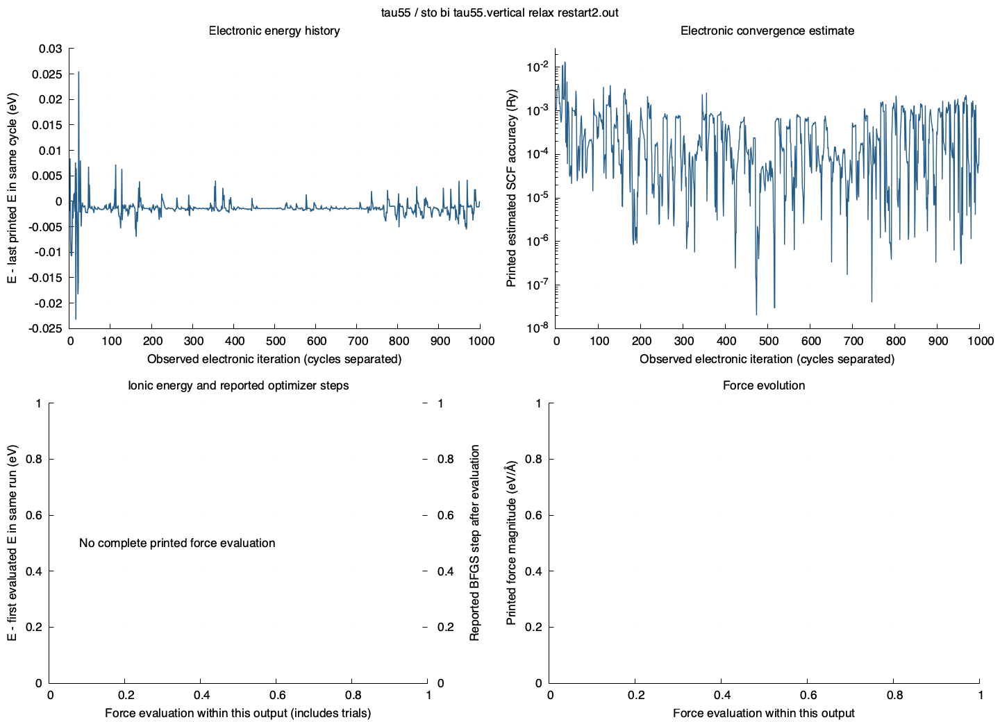

# SCF and relaxation behavior

Source: `tau55/sto_bi_tau55.vertical_relax_restart2.out`

SHA-256: `9dd7ce9d1921d3e800e28db13a755f86df6bd5aac17097c83ef80c682df3bf92` (matches the NERSC inventory).

999 observed electronic iterations; 1 SCF cycles; 0 force evaluations.

## Latest run: printed values

| Quantity | Value |
| --- | --- |
| Latest electronic-cycle outcome | NOT_CONVERGED |
| First printed total energy in latest run (Ry) | -1139.04779219 |
| Last printed total energy in latest run (Ry) | -1139.04764491 |
| Last maximum printed atomic-force norm (eV/Å) | Unavailable |
| Last QE Total force (Ry/Bohr) | Unavailable |
| Final reported BFGS steps | No final convergence counter printed |
| Latest program run reached JOB DONE | True |
| Latest program run has runtime error / time limit | False / False |

## Download exact histories

- [Electronic iterations](electronic_iterations.csv.gz): printed QE iteration number, total energy in Ry, estimated SCF accuracy and source lines. Restart numbering is preserved.
- [SCF cycle outcomes](scf_cycles.csv): converged, not converged or unfinished, separately for every electronic cycle.

Force evaluations include trial geometries and are not automatically accepted optimizer steps. The BFGS counter can continue from an earlier restart; no unprinted steps are invented. Curves stop at file/run/cycle boundaries as applicable.

Forces are retained only where QE printed a complete force evaluation; they are not interpolated between electronic iterations. High-verbosity component-force blocks are excluded from the total atomic-force statistics. Printed zero SCF estimates are not shown on the logarithmic axis.

Electronic energies follow the convention printed by QE (including its smearing/free-energy convention). Relative energies are within a single cycle/run, never comparisons between different cells. A final plotted value is not by itself evidence of convergence.
