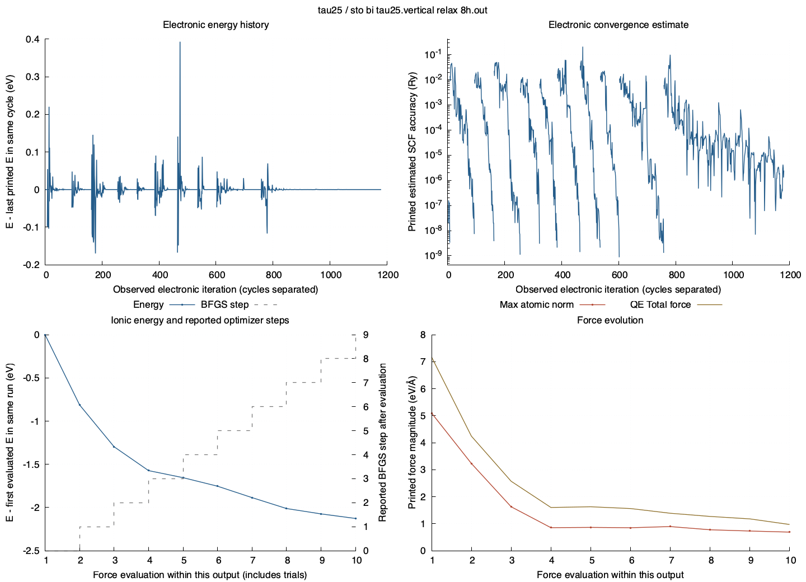

# SCF and relaxation behavior

Source: `tau25/sto_bi_tau25.vertical_relax_8h.out`

SHA-256: `02897bf1fe1a1c52a758acbaeb61c3a27c1a59b3ef1e71a0b3bd697c6bb3c00c` (matches the NERSC inventory).

1181 observed electronic iterations; 11 SCF cycles; 10 force evaluations.

## Latest run: printed values

| Quantity | Value |
| --- | --- |
| Latest electronic-cycle outcome | UNFINISHED |
| First printed total energy in latest run (Ry) | -1139.01524264 |
| Last printed total energy in latest run (Ry) | -1139.17423049 |
| Last maximum printed atomic-force norm (eV/Å) | 0.6878419285674875 |
| Last QE Total force (Ry/Bohr) | 0.037724 |
| Final reported BFGS steps | No final convergence counter printed |
| Latest program run reached JOB DONE | True |
| Latest program run has runtime error / time limit | False / True |

## Download exact histories

- [Electronic iterations](electronic_iterations.csv.gz): printed QE iteration number, total energy in Ry, estimated SCF accuracy and source lines. Restart numbering is preserved.
- [SCF cycle outcomes](scf_cycles.csv): converged, not converged or unfinished, separately for every electronic cycle.
- [Force evaluations](force_evaluations.csv): QE total force, printed atomic-force maximum/RMS, SCF force correction, energy and associated cycle.
- [Reported optimizer steps](optimizer_events.csv): BFGS/SCF counters and convergence messages at their original source lines.

Force evaluations include trial geometries and are not automatically accepted optimizer steps. The BFGS counter can continue from an earlier restart; no unprinted steps are invented. Curves stop at file/run/cycle boundaries as applicable.

Forces are retained only where QE printed a complete force evaluation; they are not interpolated between electronic iterations. High-verbosity component-force blocks are excluded from the total atomic-force statistics. Printed zero SCF estimates are not shown on the logarithmic axis.

Electronic energies follow the convention printed by QE (including its smearing/free-energy convention). Relative energies are within a single cycle/run, never comparisons between different cells. A final plotted value is not by itself evidence of convergence.
