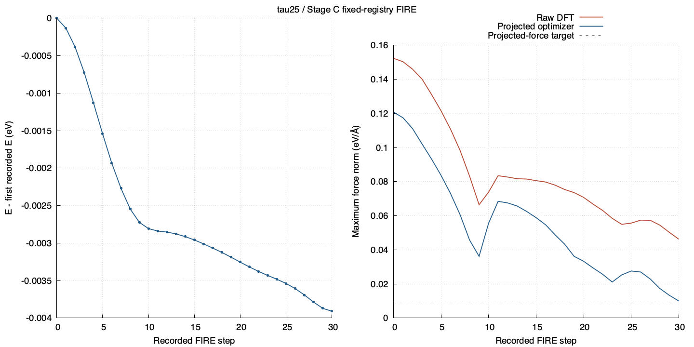

# tau25 — Stage C behavior

[Exact step data](../../../data/stage_c_fixed_registry/tau25/steps.csv) · [Source manifest](../../../data/stage_c_fixed_registry/tau25/manifest.json)

The x axis is the recorded FIRE step. Raw DFT forces and projected optimizer forces remain distinct; only the projected force is compared with the optimizer target. No inner electronic-iteration history is available from these step CSVs.
